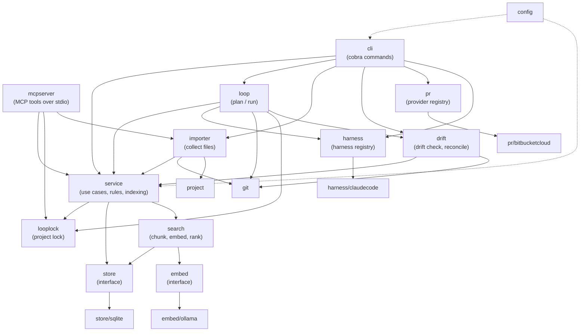
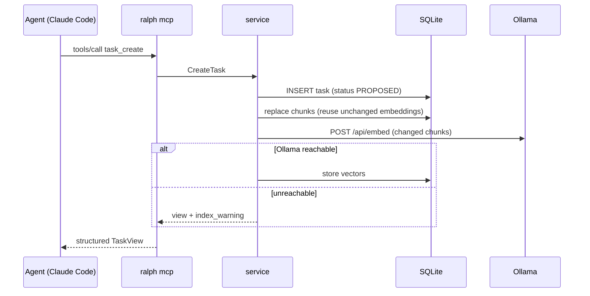

# Architecture

ralph is a single Go binary (module `github.com/bengearig/ralph`) with no cgo. Everything lives under `internal/`.

## Layering

## Packages

| Package | Responsibility |
|---|---|
| `cmd/ralph` | Entry point. Maps `errs.ErrNotImplemented` to exit code 2, `errs.ErrNeedsHuman` to exit code 3, and every other error to 1. |
| `internal/cli` | Cobra command tree. Resolves the project, loads configuration, opens the service lazily, and renders tables or `--json`. |
| `internal/config` | The `Config` struct, built-in defaults (`defaults.yaml`, embedded), layered loading with koanf, strict decoding, validation, and per-step resolution. |
| `internal/project` | Finds the project root (the nearest `.ralph/`) and the git work-tree root. |
| `internal/domain` | Entities, display IDs, slugs, document kinds, and the task state machine with its guards. No I/O. |
| `internal/store` | The persistence interface and its sentinel errors (`ErrNotFound`, `ErrConflict`). |
| `internal/store/sqlite` | SQLite implementation on `modernc.org/sqlite`: embedded migrations, entity tables, chunk storage, and FTS5. The migration runner has a rebuild mode, marked by `-- ralph:rebuild`, that backs up the database, rebuilds tables with foreign keys off, and verifies integrity and row counts before committing. |
| `internal/embed` | The embedder interface and `ErrUnavailable`. `embed/ollama` is the real client; `embed/fake` is a deterministic test double. |
| `internal/search` | Markdown-aware chunking, incremental (re)embedding, backfill, and ranking with keyword fallback. |
| `internal/service` | Use cases shared by the CLI and MCP: validation, slug allocation, status transitions, the Stall Statute, indexing on write, and JSON views. |
| `internal/mcpserver` | MCP tools as thin adapters over `service`, built with the official Go SDK. |
| `internal/harness` | The harness interface, installer interface, and registry. `harness/claudecode` runs headless `claude` sessions, parsing their stream-json output, and installs the Claude Code wiring. |
| `internal/loop` | Plans a milestone's loop (branch, ordered tasks, command, prompt) and runs it: project lock, branch preparation, one harness session per task, commits with the `Ralph-Task` trailer, recording the branch, base, head, and task commits, stashing unfinished work, and stop conditions. When it resumes on a recorded branch, it checks for drift first. It also provides the `ResolveRepo`, `DriftInput`, and `CommitSubject` helpers that `ralph milestone reconcile` and `ralph pr create` share. |
| `internal/drift` | The read-only drift check (`Check`, `Report`) that compares a milestone's recorded git state with its branch, and the reconcile actions (`Apply`). See [Drift and reconcile](loop.md#drift-and-reconcile). |
| `internal/looplock` | The project-wide loop lock on `.ralph/loop.lock`: `Acquire` and `Release` for the loop, and `Probe` to see whether and by whom it is held. Imported by `loop`, which takes the lock, and by `service`, whose deletes refuse to touch a milestone a running loop is working on. `mcpserver` imports it only to recognise `ErrLoopRunning`. |
| `internal/importer` | Collects the files to import from directories and files: resolves them inside the project root, applies git ignore rules (or walks the tree outside git), and skips files that are too large, not text, symlinks, or outside the project, with reasons. Imports `git`, `project`, and `service`, whose `ImportFile` it produces; imported by `cli` and `mcpserver`. Queueing and resolving live in `service`. |
| `internal/git` | The git commands the loop needs, run through the `git` CLI, always excluding `.ralph/`. |
| `internal/pr` | The pull-request provider interface, registry, and milestone request builder. `pr/bitbucketcloud` validates its configuration; creation is stubbed. |
| `internal/errs` | Sentinel errors shared across packages. |
| `internal/version` | Build version, from `-ldflags` or the Go toolchain's VCS stamp. |

## Design rules

- **One application layer.** The CLI and the MCP server both call `service`. The same rules apply no matter who is
  driving: the `TODO` guard, the Stall Statute, slug allocation, and indexing on write.
- **Registries for extension points.** Harnesses and pull-request providers register a factory under their config
  name in `init()`. The CLI imports implementations for their side effects. Adding a harness or provider means
  adding a package and a name to `config`'s known list; nothing else changes.
- **Writes never fail because of search.** Entity writes commit first. Indexing runs afterward, and an embedding
  failure becomes a warning (`index_warning` in JSON) that leaves chunks stale for `ralph index`.
- **stdout is sacred in `ralph mcp`.** Logs always go to stderr, because stdout carries the MCP protocol.
- **Secrets never touch config.** Config names the environment variable that holds a token, never the token itself.
  Unrelated `RALPH_*` variables are filtered out of the configuration.

## Flows

### Write through MCP

### Search

1. Load the chunks embedded with the configured model, filtered by kind and initiative.
2. Embed the query and score each chunk by cosine similarity. Keep each entity's best chunk.
3. If nothing is embedded or the query cannot be embedded, run an FTS5 `bm25` query instead and report
   `mode: keyword` with a warning.
4. Annotate hits with entity titles.

### Concurrency

Several processes can share one database: an interactive Claude Code session's `ralph mcp`, a `ralph loop`, and a
person running the CLI. SQLite runs in WAL mode with `busy_timeout`, and transactions begin `IMMEDIATE`. Each
process uses a single connection, which serializes writes within that process.
