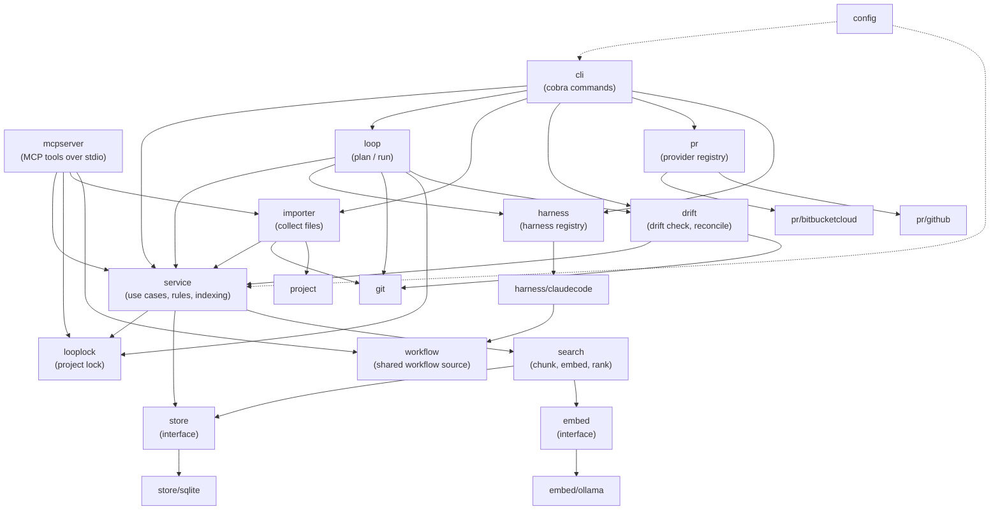
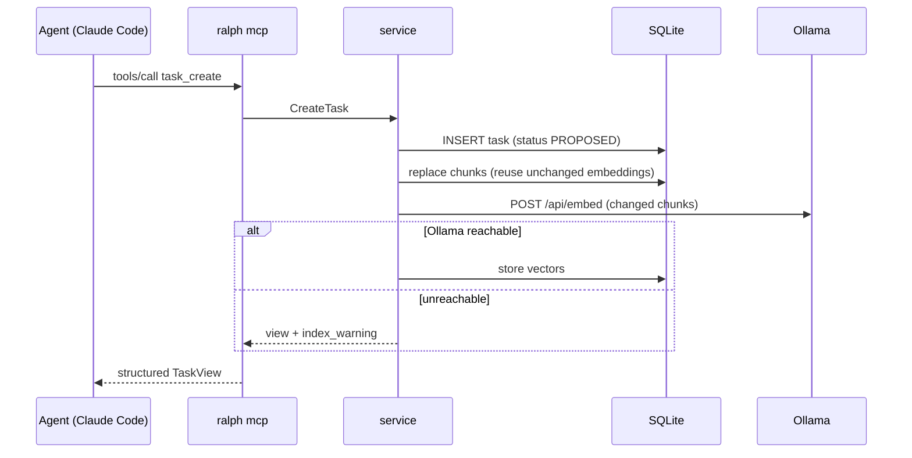

# Architecture

ralph is a single Go binary (module `github.com/bengearig/ralph`) with no cgo. Everything lives under `internal/`.

## Layering

## Packages

| Package | Responsibility |
|---|---|
| `cmd/ralph` | Entry point. Maps `errs.ErrNotImplemented` to exit code 2, `errs.ErrNeedsHuman` to exit code 3, and every other error to 1. |
| `internal/cli` | Cobra command tree. Resolves the project, loads configuration, opens the service lazily, and renders tables or `--json`. It also holds the watch engine; see [Watching](#watching). |
| `internal/config` | The `Config` struct, built-in defaults (`defaults.yaml`, embedded), layered loading with koanf, strict decoding, validation, and per-step resolution. |
| `internal/project` | Finds the project root (the nearest `.ralph/`) and the git work-tree root. |
| `internal/domain` | Entities, display IDs, slugs, document kinds, and the task state machine with its guards. No I/O. |
| `internal/store` | The persistence interface and its sentinel errors (`ErrNotFound`, `ErrConflict`). |
| `internal/store/sqlite` | SQLite implementation on `modernc.org/sqlite`: embedded migrations, entity tables, chunk storage, and FTS5. The migration runner has a rebuild mode, marked by `-- ralph:rebuild`, that backs up the database, rebuilds tables with foreign keys off, and verifies integrity and row counts before committing. |
| `internal/embed` | The embedder interface and `ErrUnavailable`. `embed/ollama` is the real client; `embed/fake` is a deterministic test double. |
| `internal/search` | Markdown-aware chunking, incremental (re)embedding, backfill, and ranking with keyword fallback. |
| `internal/service` | Use cases shared by the CLI and MCP: validation, slug allocation, status transitions, the Stall Statute, indexing on write, and JSON views. With a task manager provider it also creates cards for new resources, pushes edits and status changes to them, moves cards on delete, and syncs existing work, all outside any transaction and never failing the operation, and adds each resource's card, with its derived pending state, to the views. |
| `internal/mcpserver` | MCP tools as thin adapters over `service`, and the workflow prompts, built with the official Go SDK. |
| `internal/harness` | The harness interface, installer interface, and registry. `harness/claudecode` runs headless `claude` sessions, parsing their stream-json output, and installs the Claude Code wiring. |
| `internal/workflow` | The workflows (Receive, Articulate, Reconcile, Status, Search, and any added later) as embedded harness-neutral templates, with `List`, `Render`, and `RenderCommand`. `harness/claudecode` renders them as slash command files, and `mcpserver` serves them as MCP prompts. It imports no other ralph package. See [Shared workflow source](claude-code.md#shared-workflow-source). |
| `internal/loop` | Plans a milestone's loop (branch, ordered tasks, command, prompt) and runs it: project lock, branch preparation, one harness session per task, commits with the `Ralph-Task` trailer (and the optional `Card` trailer), recording the branch, base, head, and task commits, stashing unfinished work, and stop conditions. When it resumes on a recorded branch, it checks for drift first. When a run ends it returns to the branch it started on. `Merge` is the operation behind `ralph milestone merge`: it makes every check before touching git, then fast-forwards the base branch and optionally safe-deletes the milestone's branch (see [`ralph milestone merge`](cli.md#ralph-milestone-merge)). It also provides the `ResolveRepo`, `DriftInput`, and `CommitSubjects` helpers that `ralph milestone reconcile` and `ralph pr create` share. |
| `internal/drift` | The read-only drift check (`Check`, `Report`) that compares a milestone's recorded git state with its branch, and the reconcile actions (`Apply`). See [Drift and reconcile](loop.md#drift-and-reconcile). |
| `internal/looplock` | The project-wide loop lock on `.ralph/loop.lock`: `Acquire` and `Release` for the loop, and `Probe` to see whether and by whom it is held. Imported by `loop`, which takes the lock, and by `service`, whose deletes refuse to touch a milestone a running loop is working on. `mcpserver` imports it only to recognise `ErrLoopRunning`. |
| `internal/importer` | Collects the files to import from directories and files: resolves them inside the project root, applies git ignore rules (or walks the tree outside git), and skips files that are too large, not text, symlinks, or outside the project, with reasons. Imports `git`, `project`, and `service`, whose `ImportFile` it produces; imported by `cli` and `mcpserver`. Queueing and resolving live in `service`. |
| `internal/git` | The git commands the loop needs, run through the `git` CLI, always excluding `.ralph/`. They include the helpers merging uses: `HeadState` (the checked-out branch, or none when detached, and the commit), `MergeFFOnly` (`git merge --ff-only`, which fails rather than create a merge commit), `DeleteBranch` (the safe `git branch -d`, never `-D`), and `ResetHard`, used only to undo a fast-forward that failed part way on a clean tree. The staleness guard adds `FetchBranch` (fetches only the base branch into its remote-tracking ref, never prompting for credentials), `CompareBase` (how far the local base branch is ahead of or behind that ref), and `FastForwardBranch` (used by `pr.stale_base: sync`). `FetchBranch` and `Push` are the operations that talk to a remote: `FetchBranch` is used by `ralph loop` and `ralph pr create`, and `Push` is a plain, tracked, never forced push of one branch, used only by `ralph pr create`. |
| `internal/pr` | The pull-request provider interface, registry, and milestone request builder. The provider interface has `Validate`, `Create`, and `FindOpen`, and a `PullRequest` carries its ID, namespace, repository, number, and URL. `pr/bitbucketcloud` validates its configuration and talks to the Bitbucket Cloud REST API 2.0 through a small client; see [Bitbucket Cloud](bitbucket-cloud.md). `pr/github` does the same for github.com with a token; see [GitHub](github.md). Each provider registers its factory under its `pr.provider` name. A link registry maps a provider name to a static function that builds a pull request's URL from its namespace, repository, and number; each provider registers its function next to its factory. The service cannot import this package, so the CLI injects the lookup into the service, and the CLI and MCP views build identical links. Unregistered providers yield no URL. The milestone request's title carries the card key when the milestone has one. `ralph pr create` runs the checks, pushes the branch, asks the provider for an open pull request, creates one only when none exists, and records the result on the milestone after the provider confirms it; see [`ralph pr create`](cli.md#ralph-pr-create) and [ADR 34](adr/0034-record-pull-requests-without-urls.md). |
| `internal/taskmanager` | The provider-neutral task manager interface, the registry, and the `CardRequest` with its content hash. A provider may also implement the optional `PullRequestLinker`, which adds an idempotent pull request link to a card; `Service.LinkMilestonePullRequest` uses it, never writes to the store, and reports failure as a warning. Providers without it are skipped. It imports `config` and `domain` but must not import `service`, so that `service` can call a provider. |
| `internal/taskmanager/jira` | The Jira Cloud provider and its REST client. The client makes one attempt per call and never retries. The provider maps a card request onto Jira fields, moves issues through their workflow, and registers itself under `jira`. It implements `PullRequestLinker` with a remote link whose `globalId` makes repeats harmless. |
| `internal/taskmanager/jira/adf` | Converts Markdown to Atlassian Document Format, the rich text Jira Cloud's API takes. |
| `internal/taskmanager/fake` | A test provider that records its calls and can be told to fail. |
| `internal/errs` | Sentinel errors shared across packages. |
| `internal/version` | Build version, from `-ldflags` or the Go toolchain's VCS stamp. |
| `internal/release` | The GitHub release client for `ralph update`: finds the latest stable release, a release by tag, or the newest including pre-releases; picks the archive for the running platform; downloads it while computing its SHA-256; parses and checks `checksums.txt`; and extracts the single binary. It also compares versions by semantic version. It talks to the GitHub REST API anonymously, and its base URL is replaceable for tests. See [Installing and updating](installing.md) and [ADR 38](adr/0038-install-from-github-releases-and-update-in-place.md). |
| `internal/selfupdate` | Replaces the running executable: stages the new binary beside it, keeps its permission bits, and renames it into place, or on Windows renames the old file aside first. It never escalates privileges and leaves no staged file behind on failure. Used by `ralph update` in `cli`. |

## Design rules

- **One application layer.** The CLI and the MCP server both call `service`. The same rules apply no matter who is
  driving: the `TODO` guard, the Stall Statute, slug allocation, and indexing on write.
- **Registries for extension points.** Harnesses, pull-request providers, and task manager providers register a factory under their config
  name in `init()`. The CLI imports implementations for their side effects. Adding a harness or provider means
  adding a package and a name to `config`'s known list; nothing else changes.
- **Provider calls stay outside transactions.** The store may allow a single connection, so a transaction held across
  a slow, networked task manager call would block every other ralph command. A resource is committed first, then
  the provider is called, then the outcome is recorded in a separate write.
- **Writes never fail because of search.** Entity writes commit first. Indexing runs afterward, and an embedding
  failure becomes a warning (`index_warning` in JSON) that leaves chunks stale for `ralph index`.
- **stdout is sacred in `ralph mcp`.** Logs always go to stderr, because stdout carries the MCP protocol.
- **Secrets never touch config.** Config names the environment variable that holds a token, never the token itself.
  Unrelated `RALPH_*` variables are filtered out of the configuration.

## Flows

### Write through MCP

### Search

1. Load the chunks embedded with the configured model, filtered by kind and initiative.
2. Embed the query and score each chunk by cosine similarity. Keep each entity's best chunk.
3. If nothing is embedded or the query cannot be embedded, run an FTS5 `bm25` query instead and report
   `mode: keyword` with a warning.
4. Annotate hits with entity titles.

### Watching

A watch is the live form of a `show` command, built in `internal/cli`. Fetching a view and rendering it are separate
functions, so `show` calls both and prints exactly what it always did, while a watch calls the fetch on each poll.

- A **snapshot** is what one poll produced: the text `show` prints (made by running the render function against a
  buffer), the same view as one line of compact JSON, and a state used by `--until-done` (not done, done, or stuck).
- The **engine** (`runWatch` in `watch.go`) fetches once immediately, then every interval. A change is a snapshot whose text
  or JSON differs from the previous one, and only a change reaches the renderer. It also ticks the renderer at a short
  fixed period so a highlight can expire. It ends on cancellation, a fatal error, a write error, or `--until-done`.
  A transient fetch error (a busy or locked database, or a timeout) becomes a notice and the next poll retries.
- Two **renderers** share one small interface: start, update with the previous and current snapshot, tick, notice, and
  stop. The terminal renderer (`watch_terminal.go`) redraws in place, highlights changed lines, and draws the footer.
  The JSON-lines renderer (`watch_json.go`) writes one flushed line per change and sends notices to standard error. The
  terminal renderer is used when the output is a terminal and `--json` is not set.

`Streams` carries what the choice needs: `OutIsTerminal` reports whether `Out` is a terminal, and `OutSize` returns its
width and height, or `ok` false when unknown. `main` sets both; tests set them explicitly.

A watch never writes to the store, the repository, or a task manager. For the user-facing behaviour see
[Watching](cli.md#watching), and for the reasons behind it
[ADR 35](adr/0035-watch-by-polling-and-snapshot-comparison.md).

### Concurrency

Several processes can share one database: an interactive Claude Code session's `ralph mcp`, a `ralph loop`, and a
person running the CLI. SQLite runs in WAL mode with `busy_timeout`, and transactions begin `IMMEDIATE`. Each
process uses a single connection, which serializes writes within that process.
