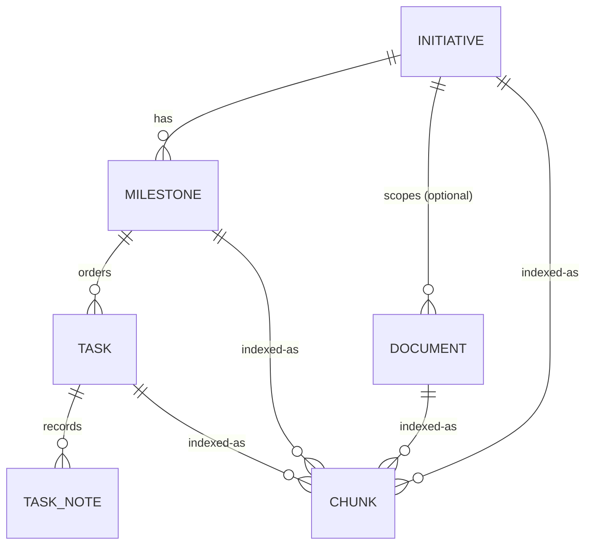
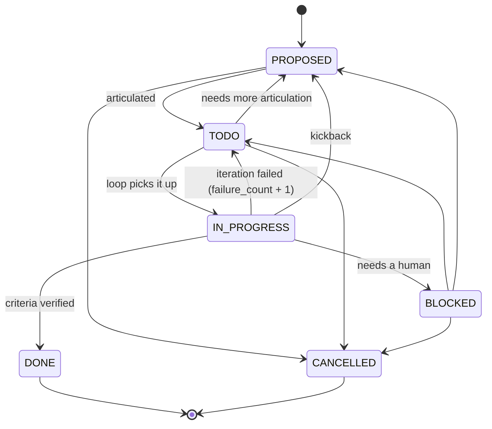

# Data model

The schema lives in `internal/store/sqlite/migrations/`. Migrations are embedded in the binary and applied
automatically when the database is opened. Applied versions are tracked in `schema_migrations`.

## Entities

### Initiative (`I-n`)

One received set of instructions. `brief` holds them verbatim. `slug` is unique. `archived_at` is empty until the
initiative is [archived](#archiving).

### Milestone (`M-n`)

An ordered group of tasks in one initiative, delivered as one branch and one pull request. `position` orders
milestones within their initiative. `slug` is unique within the initiative and feeds the branch name.

A milestone's status is **derived** from its tasks and never stored:

| Derived status | When |
|---|---|
| `EMPTY` | no tasks |
| `CANCELLED` | every task is `CANCELLED` |
| `DONE` | every task is `DONE` or `CANCELLED`, and at least one is `DONE` |
| `BLOCKED` | any task is `BLOCKED` |
| `IN_PROGRESS` | any task is `IN_PROGRESS`, or some are `DONE` and others remain |
| `ARTICULATING` | any task is still `PROPOSED` |
| `READY` | every remaining task is `TODO` |

The rows are checked top to bottom; the first match wins.

The loop records the milestone's git state as it works (see [Git records](#git-records)):

| Field | Meaning |
|---|---|
| `branch` | The branch the loop works on. Once recorded, it is used instead of `loop.branch_template`. |
| `base_commit` | The commit the branch started from: the base branch's tip when the loop created it, or its merge base with `pr.base_branch` when the loop adopted an existing branch. Stays empty if an adopted branch has no base branch or no history in common with it. |
| `head_commit` | The branch tip as the loop last left it, updated after every iteration. The loop also moves it to the tip when it resumes on a branch with commits added on top, and `ralph milestone reconcile --accept` sets it to the tip it accepts. |

### Task (`T-n`)

Receive creates tasks as `PROPOSED` with only a title and perhaps a summary. Articulate fills in the description
and acceptance criteria and promotes them to `TODO`.

| Field | Meaning |
|---|---|
| `title`, `description`, `acceptance_criteria` | What to do and how to tell it is done. |
| `status` | See the state machine below. |
| `position` | Loop order within the milestone. New tasks go last unless a position is given. |
| `failure_count` | Consecutive failed iterations; reset when the task reaches `DONE`, and when reconcile reopens it. |
| `blocked_reason` | Why the task is `BLOCKED`; cleared when it leaves `BLOCKED`. |
| `commit` | The commit the loop made when the task reached `DONE`, or the commit reconcile matched it to after history was rewritten. Empty when there is none, for example with `loop.commit_per_task: false`, nothing to commit, or no matching commit found by reconcile. See [Git records](#git-records). |

`DONE` and `CANCELLED` tasks cannot be edited. A task past `PROPOSED` must keep a non-empty description and
acceptance criteria.

### Task note (`N-n`)

Notes have display IDs so they can be deleted individually; `task show` and `task_get` list them. Kinds are `NOTE`, `ITERATION`, and `KICKBACK`. A status change made with a reason records a note automatically. The
note kind follows from the transition: kickbacks (to `BLOCKED`, or back to `PROPOSED` from later states) are
`KICKBACK`; moves out of `IN_PROGRESS` are `ITERATION`; everything else is `NOTE`.

### Document (`D-n`)

Kinds are `brief`, `architecture`, `design`, `decision`, `reference`, and `note`. A document with no initiative is
project-wide. Slugs are unique within their scope; the project scope counts as its own scope. `archived_at` is empty
until the document is [archived](#archiving).

## Git records

The milestone `branch`, `base_commit` and `head_commit` fields and the task `commit` field record what the loop did
in git. The loop page describes when each one is written: at
[branch preparation](loop.md#before-the-first-session) and after [each iteration](loop.md#each-iteration).

- Commits are stored as full object names (40 hex characters, or 64 in a SHA-256 repository), never abbreviated.
  `ralph milestone show` and `ralph task show` shorten them for display; `--json` and the MCP tools return them in
  full.
- An empty value means nothing has been recorded. Views omit empty fields from JSON.
- Only the loop and `ralph milestone reconcile` write these fields, and reconcile writes only what it finds on the
  branch (see [Drift and reconcile](loop.md#drift-and-reconcile)). They have their own store and service methods:
  milestone and task edits through the CLI or MCP never change them, and no command or tool sets them to a value of
  its choosing. Recording them does not change `updated_at`.
- In the schema, the task field is the column `tasks.commit_hash`, because `COMMIT` is an SQL keyword.

## Card records

The `cards` table records an initiative's, milestone's, or task's card in an external task manager. It is keyed by
(`kind`, `entity_id`, `provider`), so each resource has at most one row per provider. Columns: `card_key` and `url`
(the provider's key and link), `content_hash` (what was last pushed), `last_error` and `attempted_at` (the latest
failure and attempt), and `synced_at` (the last success). Empty strings mean unset.

- A row with an empty `card_key` means creation has been tried and has not succeeded. A failed update keeps the key,
  URL, hash, and `synced_at`.
- The entity is polymorphic, so there is no foreign key. `DeleteInitiative`, `DeleteMilestone`, and `DeleteTask`
  remove the cards of the deleted resource and of everything the delete cascades to, in the same transaction.
- Whether a card needs creating or updating is derived from these rows, not stored.

## Task state machine

The transition table is defined in `internal/domain/status.go`, which is the source of truth for this diagram.

Guards:

- **To `TODO`.** The task needs a non-empty description and acceptance criteria. This is how "articulated enough to
  loop" is enforced.
- **To `BLOCKED`.** A reason is required.
- **Stall Statute.** When `IN_PROGRESS → TODO` would bring `failure_count` to `loop.stall_threshold`, the service
  moves the task to `BLOCKED` instead and records the reason.

### Reopening

`DONE` is terminal in the transition table, and stays so: `ralph task status`, the `task_set_status` MCP tool, and
every other status change reject a move out of `DONE`, and a `DONE` task lists no allowed next statuses. That is why
the diagram above has no `DONE → TODO` arrow.

The one exception is a separate service operation, `ReopenTask`, outside the transition table. Only
[`ralph milestone reconcile --reopen`](cli.md#ralph-milestone-reconcile) calls it, for a task whose work was lost from
the branch, for example by a reset. It requires the task to be `DONE` and a non-empty reason, and in one transaction:

- sets the status to `TODO`, so the loop picks the task up again;
- resets `failure_count` to 0 and clears `blocked_reason`;
- clears the recorded `commit`;
- adds a `NOTE`: `Reopened by reconcile: <reason>`.

## Display IDs and slugs

Rows use integer primary keys. Users and agents see display IDs (`T-12`), with prefixes `I`, `M`, `T`, `D`, and `N`
(task notes). Inputs accept the display form or a bare
number, and a prefix for the wrong kind is rejected. Slugs are lowercase ASCII with single dashes. When no slug is
given, one is derived from the title, with `-2`, `-3`, and so on appended on collision.

IDs are never reused. The tables behind `I-n`, `M-n`, `T-n`, `D-n`, and `N-n` use `AUTOINCREMENT` (migration
`0003`), so deleting the newest row and creating another gives a higher number, and a reference such as `T-9` in a
note, commit, or pull request never silently points at a different task. Deletes leave gaps in the sequences. IDs
are still per database, so not stable across clones. See
[ADR 0018](adr/0018-permanent-ids-and-guarded-deletes.md).

## Deleting

Cancelling is the default way to drop planned work: `CANCELLED` keeps the task, its notes, and the reason. Deleting
is permanent and is for items created by mistake, such as duplicates or items created in the wrong place. Agents ask
the user before deleting and never pass `force` without explicit approval. See
[CLI](cli.md#deleting) and [MCP server](mcp.md#deleting).

| Delete | Without `force` | With `force` |
|---|---|---|
| Initiative | Refused if it has milestones or documents. | Cascades to its milestones, their tasks and notes, and its documents. |
| Milestone | Refused if it has tasks. | Cascades to its tasks and their notes. |
| Task | Refused if it is `IN_PROGRESS` or `DONE`. | Deleted with its notes. |
| Document | Allowed. | Not applicable. |
| Note | Allowed. | Not applicable. |

- **Guards live in the service**, so the CLI and MCP behave identically. A refusal names what blocks the delete and
  wraps `service.ErrNeedsForce`; the adapters turn it into a `--force` or `force: true` hint.
- **Cascades and chunks.** Cascades use the `ON DELETE CASCADE` foreign keys, and the `*_ad` triggers remove the
  deleted entities' chunks and their search index entries. Each delete runs in one transaction and reports how many
  rows of each kind it removed.
- **Loop-lock guard.** While a loop holds `.ralph/loop.lock`, a delete that affects the loop's milestone (the
  milestone, a task or note in it, or its initiative) is refused even with `force`. The error names the holder's PID
  and milestone. Stop the loop first.
- **No git side effects.** A milestone's recorded branch is never touched.

## Archiving

Archiving hides finished initiatives and documents without deleting them, and makes them read-only. Only initiatives
and documents have an `archived_at` column. It is empty when the item is not archived, and otherwise holds the time
of archiving as an RFC 3339 timestamp. Archiving does not change `updated_at`.

Milestones and tasks have no flag of their own; they inherit the state of their initiative. The **effective state**
is computed whenever it is needed:

| Entity | Archived when |
|---|---|
| Initiative | its `archived_at` is set |
| Milestone, task | their initiative is archived |
| Initiative-scoped document | its own `archived_at` is set, or its initiative is archived |
| Project-wide document | its own `archived_at` is set |

Views report the state: initiatives and documents carry `archived_at`, a document whose initiative is archived also
reports `archived`, and milestones and tasks report `archived`.

- **Read-only.** While an item is effectively archived, anything that would change it or anything under it is refused
  with `service.ErrArchived`, whose message names the archived item and says to unarchive it first. That covers
  updates, status changes, reopening, adding notes, creating milestones, tasks, or documents under an archived
  initiative, and writing git records (and so applying drift reconciliation).
- **Still allowed.** Archive, unarchive, get by ID, and deletes, which keep their [guards](#deleting) including
  `force`. Archiving an archived item, or unarchiving one that is not archived, does nothing.
- **Hiding.** List, status, and search operations leave out effectively archived items unless the caller opts in with
  `--archived` on the [CLI](cli.md#archiving) or `include_archived` on the [MCP server](mcp.md#archiving). Get by ID
  always works. Results do not say that anything was hidden. Search applies the filter when it queries chunks, so
  archiving and unarchiving need no re-indexing.
- **Loop lock.** Archiving or unarchiving an initiative is refused, even by a caller that could otherwise force it,
  while a loop holds one of its milestones. Stop the loop first. The loop and `ralph pr create` in turn refuse
  milestones of archived initiatives; see [the loop](loop.md#before-the-first-session).

See [ADR 0019](adr/0019-archive-initiatives-and-documents.md).

## Search index

| Table | Purpose |
|---|---|
| `chunks` | One row per chunk: owner kind and ID, initiative (for filtering), sequence, text, SHA-256 content hash, model, dimensions, and the embedding as little-endian float32. |
| `chunks_fts` | An FTS5 external-content index over `chunks.text` (porter stemming), kept in sync by triggers. |

Chunking rules:

- Documents are split on markdown headings outside fenced code. Small sections are packed together up to
  `embeddings.chunk.max_chars`; oversized sections are windowed with `overlap_chars` of overlap. Every chunk starts
  with the entity's title.
- Initiatives index their title and brief. Milestones index their title and description. Tasks index their title,
  description, and acceptance criteria.
- When an entity is rewritten, chunks whose content hash and model are unchanged keep their embeddings. Only new
  text is sent to the embedder.
- A chunk is **stale** when it has no embedding for the configured model. `ralph index` embeds stale chunks;
  `ralph index --rebuild` rechunks everything first.
- Deleting an entity, including through a foreign-key cascade, removes its chunks through triggers. See
  [Deleting](#deleting). Cancelling is the default way to drop a task.
- Archived items keep their chunks and embeddings; search filters them out at query time. See
  [Archiving](#archiving).
