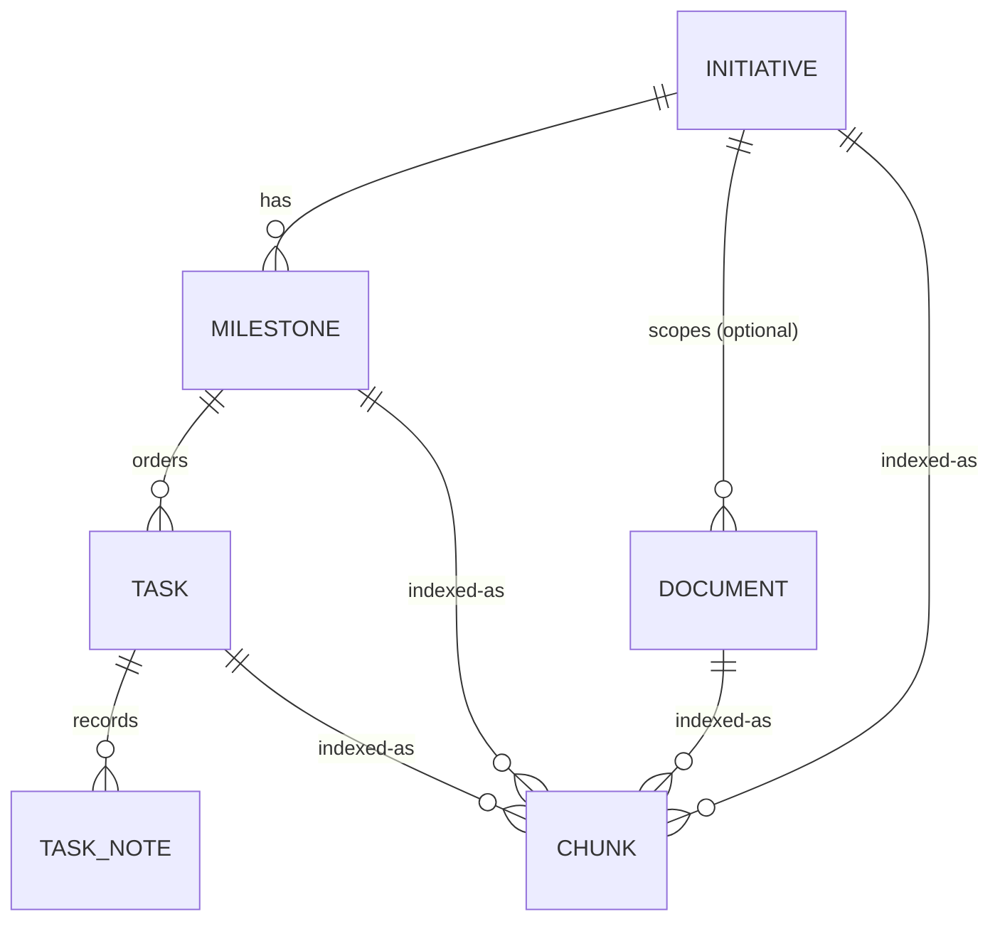
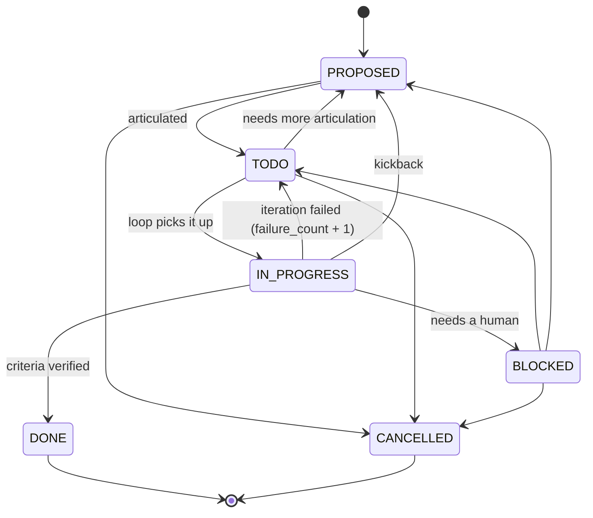

# Data model

The schema lives in `internal/store/sqlite/migrations/`. Migrations are embedded in the binary and applied
automatically when the database is opened. Applied versions are tracked in `schema_migrations`.

## Entities

### Initiative (`I-n`)

One received set of instructions. `brief` holds them verbatim. `slug` is unique.

### Milestone (`M-n`)

An ordered group of tasks in one initiative, delivered as one branch and one pull request. `position` orders
milestones within their initiative. `slug` is unique within the initiative and feeds the branch name.

A milestone's status is **derived** from its tasks and never stored:

| Derived status | When |
|---|---|
| `EMPTY` | no tasks |
| `CANCELLED` | every task is `CANCELLED` |
| `DONE` | every task is `DONE` or `CANCELLED`, and at least one is `DONE` |
| `BLOCKED` | any task is `BLOCKED` |
| `IN_PROGRESS` | any task is `IN_PROGRESS`, or some are `DONE` and others remain |
| `ARTICULATING` | any task is still `PROPOSED` |
| `READY` | every remaining task is `TODO` |

The rows are checked top to bottom; the first match wins.

The loop records the milestone's git state as it works (see [Git records](#git-records)):

| Field | Meaning |
|---|---|
| `branch` | The branch the loop works on. Once recorded, it is used instead of `loop.branch_template`. |
| `base_commit` | The commit the branch started from: the base branch's tip when the loop created it, or its merge base with `pr.base_branch` when the loop adopted an existing branch. Stays empty if an adopted branch has no base branch or no history in common with it. |
| `head_commit` | The branch tip as the loop last left it, updated after every iteration. |

### Task (`T-n`)

Receive creates tasks as `PROPOSED` with only a title and perhaps a summary. Articulate fills in the description
and acceptance criteria and promotes them to `TODO`.

| Field | Meaning |
|---|---|
| `title`, `description`, `acceptance_criteria` | What to do and how to tell it is done. |
| `status` | See the state machine below. |
| `position` | Loop order within the milestone. New tasks go last unless a position is given. |
| `failure_count` | Consecutive failed iterations; reset when the task reaches `DONE`. |
| `blocked_reason` | Why the task is `BLOCKED`; cleared when it leaves `BLOCKED`. |
| `commit` | The commit the loop made when the task reached `DONE`. Empty when the loop made none, for example with `loop.commit_per_task: false` or nothing to commit. See [Git records](#git-records). |

`DONE` and `CANCELLED` tasks cannot be edited. A task past `PROPOSED` must keep a non-empty description and
acceptance criteria.

### Task note

Kinds are `NOTE`, `ITERATION`, and `KICKBACK`. A status change made with a reason records a note automatically. The
note kind follows from the transition: kickbacks (to `BLOCKED`, or back to `PROPOSED` from later states) are
`KICKBACK`; moves out of `IN_PROGRESS` are `ITERATION`; everything else is `NOTE`.

### Document (`D-n`)

Kinds are `brief`, `architecture`, `design`, `decision`, `reference`, and `note`. A document with no initiative is
project-wide. Slugs are unique within their scope; the project scope counts as its own scope.

## Git records

The milestone `branch`, `base_commit` and `head_commit` fields and the task `commit` field record what the loop did
in git. The loop page describes when each one is written: at
[branch preparation](loop.md#before-the-first-session) and after [each iteration](loop.md#each-iteration).

- Commits are stored as full object names (40 hex characters, or 64 in a SHA-256 repository), never abbreviated.
  `ralph milestone show` and `ralph task show` shorten them for display; `--json` and the MCP tools return them in
  full.
- An empty value means nothing has been recorded. Views omit empty fields from JSON.
- Only the loop writes these fields. A later reconcile step is planned to write them too. They have their own store
  and service methods: milestone and task edits through the CLI or MCP never change them, and no command or tool
  sets them directly. Recording them does not change `updated_at`.
- In the schema, the task field is the column `tasks.commit_hash`, because `COMMIT` is an SQL keyword.

## Task state machine

The transition table is defined in `internal/domain/status.go`, which is the source of truth for this diagram.

Guards:

- **To `TODO`.** The task needs a non-empty description and acceptance criteria. This is how "articulated enough to
  loop" is enforced.
- **To `BLOCKED`.** A reason is required.
- **Stall Statute.** When `IN_PROGRESS → TODO` would bring `failure_count` to `loop.stall_threshold`, the service
  moves the task to `BLOCKED` instead and records the reason.

## Display IDs and slugs

Rows use integer primary keys. Users and agents see display IDs (`T-12`). Inputs accept the display form or a bare
number, and a prefix for the wrong kind is rejected. Slugs are lowercase ASCII with single dashes. When no slug is
given, one is derived from the title, with `-2`, `-3`, and so on appended on collision.

## Search index

| Table | Purpose |
|---|---|
| `chunks` | One row per chunk: owner kind and ID, initiative (for filtering), sequence, text, SHA-256 content hash, model, dimensions, and the embedding as little-endian float32. |
| `chunks_fts` | An FTS5 external-content index over `chunks.text` (porter stemming), kept in sync by triggers. |

Chunking rules:

- Documents are split on markdown headings outside fenced code. Small sections are packed together up to
  `embeddings.chunk.max_chars`; oversized sections are windowed with `overlap_chars` of overlap. Every chunk starts
  with the entity's title.
- Initiatives index their title and brief. Milestones index their title and description. Tasks index their title,
  description, and acceptance criteria.
- When an entity is rewritten, chunks whose content hash and model are unchanged keep their embeddings. Only new
  text is sent to the embedder.
- A chunk is **stale** when it has no embedding for the configured model. `ralph index` embeds stale chunks;
  `ralph index --rebuild` rechunks everything first.
- Deleting an entity, including through a foreign-key cascade, removes its chunks through triggers. The CLI exposes
  no delete commands yet; `CANCELLED` is the supported way to drop a task.
