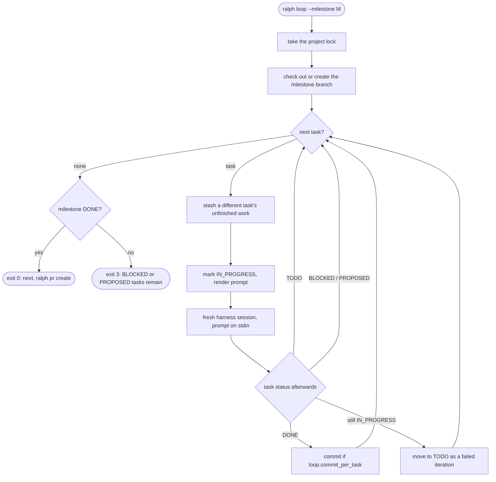

# The loop

## Principles

- **Ralph is a bash loop.** ralph is an external orchestrator. It starts a **fresh** harness session for every
  iteration, so no context accumulates across iterations. See [ADR 0007](adr/0007-external-loop-orchestrator.md).
- **The plan is the memory.** Each iteration learns what to do from the store: the task's description, acceptance
  criteria, and notes, plus the documents. Anything an iteration wants its successor to know must be written as an
  `ITERATION` note.
- **One milestone, one branch, one pull request.** See
  [ADR 0009](adr/0009-branch-and-pull-request-per-milestone.md).

## Planning

`loop.Planner.Plan` resolves, without changing anything:

| Item | Source |
|---|---|
| Branch | `loop.branch_template`, rendered with the initiative and milestone, then checked against git's ref-name rules. |
| Base branch | `pr.base_branch`. |
| Harness and model | `steps.loop`, falling back to `harness.default` and that harness's model. |
| Command | The harness's headless argv. The prompt goes on stdin. |
| Tasks | `IN_PROGRESS` tasks (interrupted work) first, then `TODO` tasks by position. |
| Prompt | The first iteration's prompt, rendered from `loop.prompt_template` or the built-in [`prompt.md`](../internal/loop/prompt.md). |
| Warnings | `PROPOSED` tasks that will not be looped, `BLOCKED` tasks, and more loopable tasks than `loop.max_iterations`. |

```sh
ralph loop --milestone M-1 --dry-run --show-prompt
ralph --json loop --milestone M-1 --dry-run
```

### Prompt template

The template is Go `text/template` with `missingkey=error`. It can use these fields: `.Project`, `.Initiative` and
`.Milestone` (each with `.ID`, `.Slug`, `.Title`), `.Branch`, `.Task` (the full task view, including `.Notes`),
`.Iteration`, `.MaxIterations`, `.StallThreshold`, and `.CommitPerTask`.

## Running

```sh
ralph loop --milestone M-1
```



### Before the first session

1. **Lock.** The loop takes an exclusive lock on `.ralph/loop.lock` for the whole project, because one working tree
   can only serve one loop. A second `ralph loop` fails and names the PID and milestone holding the lock. The
   operating system releases the lock if ralph dies.
2. **Branch.** The loop then checks out the milestone branch:
   - If it is already checked out, the loop continues even with uncommitted changes. Those are the previous run's
     unfinished work.
   - If it needs to switch branches, a dirty working tree is refused, listing the changed paths.
   - If the branch exists, the loop switches to it.
   - Otherwise it creates the branch from `pr.base_branch`, falling back to `origin/<base>`, without tracking.
3. **Ignored paths.** Changes under `.ralph/` are never counted, staged, or stashed.

### Each iteration

1. `NextTask` picks an interrupted `IN_PROGRESS` task first, otherwise the first `TODO` task by position. `BLOCKED` and
   `PROPOSED` tasks are skipped, so one stuck task does not hold up the rest.
2. If the previous session left a *different* task unfinished, its uncommitted changes are stashed as
   `ralph: T-n <STATUS>, unfinished work` (see `git stash list`). This keeps every commit limited to its own task. A
   retry of the same task keeps its earlier work.
3. A `TODO` task is moved to `IN_PROGRESS`. The prompt is rendered with the task's latest notes.
4. The harness runs one fresh session. The prompt is saved as `.ralph/runs/<M-n>/<time>-<iteration>-<T-n>.prompt.md`
   and the full stream-json transcript as the matching `.jsonl` file. The terminal shows a short feed: tool calls,
   brief agent text, and a summary line with turns, cost, and log path.
5. ralph acts on the task's status after the session:

   | Status | What happens |
   |---|---|
   | `DONE` | Commit the changes, if `loop.commit_per_task`, using `loop.commit_template`. Commit hooks run. A failed commit stops the loop. |
   | `TODO` | The agent reported an unfinished iteration; the failure count was incremented. |
   | `BLOCKED`, `PROPOSED` | Report it and move on. |
   | still `IN_PROGRESS` | The session ended without reporting. Move the task to `TODO` with a reason describing the session's exit, result type, and final message. |

   The Stall Statute applies to both failure paths: the failure that reaches `loop.stall_threshold` blocks the task.

### Stopping

| Situation | Exit code | Task state |
|---|---|---|
| Milestone `DONE` (or all tasks `CANCELLED`) | `0` | — |
| Nothing loopable left, but `BLOCKED` or `PROPOSED` tasks remain | `3` | as reported |
| `loop.max_iterations` reached with work left | `3` | rerun to continue |
| Ctrl-C or `SIGTERM` | `1` | current task stays `IN_PROGRESS`; rerun resumes it |
| The `ralph` MCP server did not connect in the session | `1` | stays `IN_PROGRESS`, no failure counted |
| Harness could not start, or a git failure | `1` | stays `IN_PROGRESS`; see the message |
| A `DONE` task's commit failed (for example, a hook rejected it) | `1` | stays `DONE`; commit by hand, then rerun |

When it stops, the loop prints a one-line summary on stdout (`--json` prints the full outcome), and the feed on
stderr explains what needs attention. Unfinished changes from the last task are left in the working tree, and the
feed says so.

### Requirements

- **Approve the MCP server once.** Headless sessions use the project's `.mcp.json`. Claude Code requires you to
  approve that server interactively first: run `claude` in the project once and approve `ralph`. The loop checks each
  session's startup report and stops at once with instructions if the server did not connect.
- **Permissions.** Sessions run with `--permission-mode auto` by default (`harness.claude_code.permission_mode`) and
  always with `--permission-prompts none`: nobody is there to answer, so anything that would prompt is denied. The
  agent records such failures like any other unfinished iteration.
- **Spending cap.** Set `harness.claude_code.max_budget_usd` to cap each session; a session that hits it counts as a
  failed iteration.
