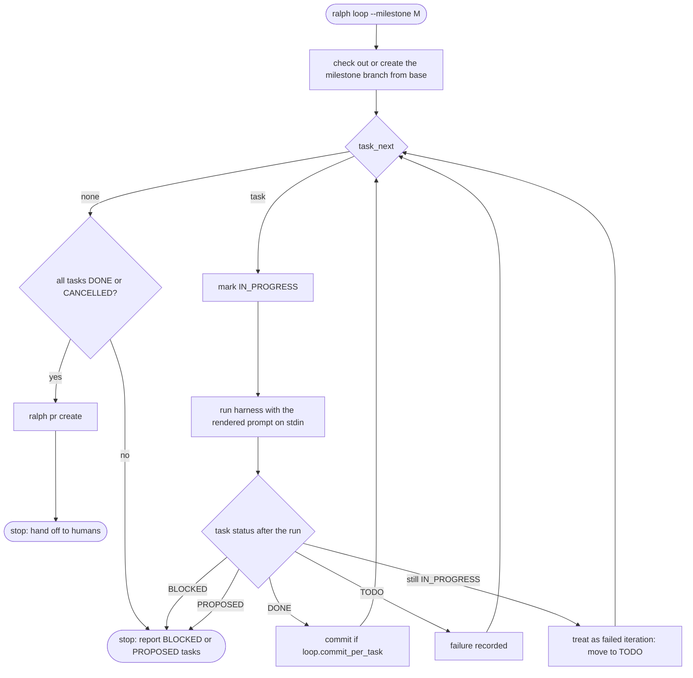

# The loop

> **Status:** planning and `--dry-run` work today. Execution returns "not implemented" (exit code 2). This page
> describes both what exists and the intended design, and marks which is which.

## Principles

- **Ralph is a bash loop.** ralph is an external orchestrator. It starts a **fresh** harness session for every
  iteration, so no context accumulates across iterations. See [ADR 0007](adr/0007-external-loop-orchestrator.md).
- **The plan is the memory.** Each iteration learns what to do from the store: the task's description, acceptance
  criteria, and notes, plus the documents. Anything an iteration wants its successor to know must be written as an
  `ITERATION` note.
- **One milestone, one branch, one pull request.** See
  [ADR 0009](adr/0009-branch-and-pull-request-per-milestone.md).

## Planning (implemented)

`loop.Planner.Plan` resolves, without changing anything:

| Item | Source |
|---|---|
| Branch | `loop.branch_template`, rendered with the initiative and milestone, then checked against git's ref-name rules. |
| Base branch | `pr.base_branch`. |
| Harness and model | `steps.loop`, falling back to `harness.default` and that harness's model. |
| Command | The harness's headless argv. The prompt goes on stdin. |
| Tasks | `IN_PROGRESS` tasks (interrupted work) first, then `TODO` tasks by position. |
| Prompt | The first iteration's prompt, rendered from `loop.prompt_template` or the built-in [`prompt.md`](../internal/loop/prompt.md). |
| Warnings | `PROPOSED` tasks that will not be looped, `BLOCKED` tasks, and more loopable tasks than `loop.max_iterations`. |

```sh
ralph loop --milestone M-1 --dry-run --show-prompt
ralph --json loop --milestone M-1 --dry-run
```

### Prompt template

The template is Go `text/template` with `missingkey=error`. It can use these fields: `.Project`, `.Initiative` and
`.Milestone` (each with `.ID`, `.Slug`, `.Title`), `.Branch`, `.Task` (the full task view, including `.Notes`),
`.Iteration`, `.MaxIterations`, `.StallThreshold`, and `.CommitPerTask`.

## Execution (planned)



Rules to implement:

1. **Budget.** Stop after `loop.max_iterations` harness runs.
2. **Stall Statute.** This is already enforced by the service: a failed iteration that reaches
   `loop.stall_threshold` moves the task to `BLOCKED`. The loop then stops and asks for help instead of moving on.
3. **Harness exit codes.** A non-zero exit or a crash counts as a failed iteration. Output is streamed and kept for
   diagnosis.
4. **Commits.** After each `DONE` task, if `loop.commit_per_task`, commit with a message derived from the task.
   Agents are told not to commit themselves.
5. **Interruption.** On Ctrl-C, stop the harness and leave the task `IN_PROGRESS`. The next run resumes it first.
6. **Single runner.** Take a lock so two loops cannot run the same milestone at once.

Open questions are tracked in the [roadmap](roadmap.md).
