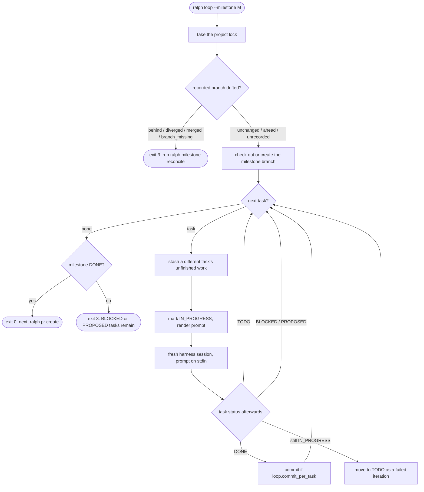

# The loop

## Principles

- **Ralph is a bash loop.** ralph is an external orchestrator. It starts a **fresh** harness session for every
  iteration, so no context accumulates across iterations. See [ADR 0007](adr/0007-external-loop-orchestrator.md).
- **The plan is the memory.** Each iteration learns what to do from the store: the task's description, acceptance
  criteria, and notes, plus the documents. Anything an iteration wants its successor to know must be written as an
  `ITERATION` note.
- **One milestone, one branch, one pull request.** See
  [ADR 0009](adr/0009-branch-and-pull-request-per-milestone.md).

## Planning

`loop.Planner.Plan` resolves, without changing anything:

| Item | Source |
|---|---|
| Branch | The milestone's recorded `branch`, if any. Otherwise `loop.branch_template`, rendered with the initiative and milestone, then checked against git's ref-name rules. Planning makes no git calls, so drift, including a recorded branch that no longer exists, is only noticed when the loop runs. |
| Base branch | `pr.base_branch`. |
| Harness and model | `steps.loop`, falling back to `harness.default` and that harness's model. |
| Command | The harness's headless argv. The prompt goes on stdin. |
| Tasks | `IN_PROGRESS` tasks (interrupted work) first, then `TODO` tasks by position. |
| Prompt | The first iteration's prompt, rendered from `loop.prompt_template` or the built-in [`prompt.md`](../internal/loop/prompt.md). |
| Warnings | `PROPOSED` tasks that will not be looped, `BLOCKED` tasks, and more loopable tasks than `loop.max_iterations`. |

```sh
ralph loop --milestone M-1 --dry-run --show-prompt
ralph --json loop --milestone M-1 --dry-run
```

### Prompt template

The template is Go `text/template` with `missingkey=error`. It can use these fields: `.Project`, `.Initiative` and
`.Milestone` (each with `.ID`, `.Slug`, `.Title`), `.Branch`, `.Task` (the full task view, including `.Notes`),
`.Iteration`, `.MaxIterations`, `.StallThreshold`, and `.CommitPerTask`.

## Card keys in commits

`loop.commit_template` can put the task's card key in the commit message. `.Task` has two extra fields, taken from the
task's own card in ralph, not from its milestone's or initiative's: `.Task.CardKey`, such as `ABC-1235`, and
`.Task.CardKeyPrefix`, the key in square brackets followed by a space, `[ABC-1235] `. Both are empty when the task has no
card. The default template does not use them, so nothing changes until a team edits the template.

With `{{.Task.CardKeyPrefix}}{{.Task.ID}}: {{.Task.Title}}` as the template, a task titled "Add the Jira client" gets
the subject `[ABC-1235] T-12: Add the Jira client` when its card is `ABC-1235`, and `T-12: Add the Jira client` when it
has no card.

- **Cleaning without a card.** When the template uses a key field and the task has no card, the first line of the
  message is tidied so the missing key leaves nothing behind: empty `[]` and `()` pairs are removed, runs of spaces
  collapse to one, and leading spaces, `:`, `-`, `,` and `;` are trimmed. Later lines are untouched. A template that
  does not use the key fields is never cleaned, and a message that comes out empty still falls back to
  `<task ID>: <task title>`.
- **The `Card:` trailer.** With [`loop.commit_card_trailer`](configuration.md#loop) on, the commit gets a
  `Card: <key>` trailer after `Ralph-Task`, only when the task has a card. It is independent of
  `loop.commit_trailer` and of the template, and it keeps the key on the commit when the subject is later reworded.
  It is off by default.
- **No Jira calls.** Naming a commit reads only the key ralph has recorded for the task. It never calls the task
  manager and never creates a card; a task without a card simply has no key.
- **Drift.** The drift check tries the `Ralph-Task` trailer first, then the patch id, then the subject (see
  [Task matchers](#task-matchers)). The subject matcher tries the subject rendered with the task's current key, and
  then the same subject rendered without a key, so commits made before the task had a card, or before the template
  used the key, still match. A commit whose key has since changed cannot be rebuilt from ralph's records; only its
  `Ralph-Task` trailer can match it, which is why `loop.commit_trailer` should stay on. Adding a key therefore does not
  make matched work look lost, as long as the trailer is there.

## Branch names

A milestone's branch name comes from `loop.branch_template`, a Go `text/template` rendered with `.Initiative` and
`.Milestone`. Each has `.ID`, `.Slug`, `.Title`, `.CardKey`, and `.CardKeyPrefix`. `.CardKey` is the task manager
card key recorded in ralph for that entity, such as `ABC-1234`, and is empty when the entity has no card.
`.CardKeyPrefix` is the key followed by `-`, or empty. The default template, `ralph/{{.Milestone.Slug}}`, does not use
them, so nothing changes until a team edits the template.

- **The recorded branch wins.** A milestone that already has a recorded branch keeps it. A card that appears later
  never renames a branch the loop has created, and neither does changing the template.
- **One name everywhere.** The loop, `ralph pr create`, and the drift check all compute the name through the same code,
  from the same recorded card keys, so they cannot disagree.
- **No Jira calls.** Naming a branch reads only the keys ralph has recorded. It never calls Jira and never creates a
  card. A milestone has a key only if its card exists in ralph, which happens when the milestone is created with a
  [task manager](jira.md) configured. There is no command that creates cards for milestones that predate the
  provider, so those are named without a key.
- **The prompt template does not get the key fields.** Commit messages have their own, for the task's card; see
  [Card keys in commits](#card-keys-in-commits).

With `{{.Milestone.CardKeyPrefix}}{{.Milestone.Slug}}` as the template, a milestone titled "Implement cool feature"
gets `ABC-1234-implement-cool-feature` when its card is `ABC-1234`, and `implement-cool-feature` when it has no card.

When a key is empty and the template uses a key field, the name is cleaned up so the missing key leaves no stray
separator:

- Leading `-`, `_`, and `.` are removed from each `/`-separated part, and repeated `-` collapse to one. So
  `{{.Milestone.CardKey}}-{{.Milestone.Slug}}` gives `implement-cool-feature`, and `feature/{{.Milestone.CardKey}}-x`
  gives `feature/x`.
- A template that does not use the key fields is never cleaned, so existing names are never altered.
- If the name rendered with the keys is not a valid git branch name, for example because a key contains a character
  git rejects, the loop names the branch as if there were no keys instead of failing.

Names are inconsistent across milestones when only some have cards. That is the accepted cost of falling back to the
plain name. See [ADR 23](adr/0023-card-keys-in-branch-names.md).

## Running

```sh
ralph loop --milestone M-1
```



### Before the first session

0. **Archive check.** The loop refuses a milestone whose initiative is archived, with an error naming the
   initiative and the `ralph initiative unarchive` command. `ralph pr create` does the same. See
   [Archiving](data-model.md#archiving).
1. **Lock.** The loop takes an exclusive lock on `.ralph/loop.lock` for the whole project, because one working tree
   can only serve one loop. A second `ralph loop` fails and names the PID and milestone holding the lock. The
   operating system releases the lock if ralph dies.
2. **Drift check.** When the milestone has a recorded branch, the loop compares the branch with the record (see
   [Drift and reconcile](#drift-and-reconcile)) before it switches branches or touches the working tree:

   | State | What the loop does |
   |---|---|
   | `unchanged` | Proceeds. |
   | `ahead` | Warns, listing the commits beyond the recorded head (`! M-1 branch has 1 commit(s) beyond the recorded head:`, then one line per commit), records the tip as the new head, and proceeds. |
   | `behind`, `diverged`, `merged`, `branch_missing` | Refuses with exit code `3`, without switching branches. The feed and the error name the state and say `run: ralph milestone reconcile <M-n>`. |

   A refusal comes before the dirty-tree check, so the drift is what gets reported. A milestone without a record
   skips the drift check and is recorded on first use (see **Record** below). `--dry-run` makes no git calls and skips it too.
3. **Branch.** The loop then checks out the milestone branch:
   - The branch is the milestone's recorded `branch` when it has one, so changing `loop.branch_template`, or a
     milestone title it uses, does not move work to a new branch. Without a recorded branch, the name comes from the
     template. A recorded branch that no longer exists has already been refused by the drift check; to point the record at a
     renamed branch, use `ralph milestone reconcile <M-n> --branch <name>`.
   - If it is already checked out, the loop continues even with uncommitted changes. Those are the previous run's
     unfinished work.
   - If it needs to switch branches, a dirty working tree is refused, listing the changed paths.
   - If the branch exists, the loop switches to it.
   - Otherwise it creates the branch from `pr.base_branch`, falling back to `origin/<base>`, without tracking.
4. **Record.** The loop then records the milestone's git state (see [Git records](data-model.md#git-records)):
   - **It created the branch.** It records the branch, and records the commit it started from as both
     `base_commit` and `head_commit`.
   - **The branch already existed and the milestone has no record** (trust on first use). It records the branch,
     the current tip as `head_commit`, and the merge base with `pr.base_branch` (or `origin/<base>`) as
     `base_commit`. If the base branch can't be found, or the two share no history, the feed warns and
     `base_commit` stays empty. Tasks finished before the record existed keep an empty `commit`.
   - **The milestone is already recorded.** The record is left as it is, apart from the head the drift check moved
     for an `ahead` branch.

   `--dry-run` records nothing.
5. **Ignored paths.** Changes under `.ralph/` are never counted, staged, or stashed.

### Milestone dependencies

A milestone can record the milestones it depends on (see [Milestone dependencies](data-model.md#milestone-dependencies)).
`ralph loop --milestone` and `ralph pr create --milestone` check them first, before the lock, the drift check, or any
git change, so a refusal leaves the repository and the working tree as they were. Each dependency is checked in ID order:

| Dependency | Result |
|---|---|
| `CANCELLED` (every task cancelled) | Satisfied: it will never be merged. |
| Any status other than `DONE` | Not satisfied. |
| `DONE` and the drift check reports `merged` | Satisfied. |
| `DONE` and the drift check reports `unrecorded` or `branch_missing` | Not satisfied: whether it was merged cannot be told. |
| `DONE` and any other drift state | Not satisfied: its branch is not merged into `pr.base_branch`. |

A cancelled dependency counts as satisfied and an unknowable one refuses, rather than warning. What counts as merged is
the drift check's own test (see [States](#states)), so work that was fast-forwarded, squashed, or rebased into the base
branch counts.

An unsatisfied dependency stops the command with exit code `3`. Each one gets a line of the form
`<milestone> depends on <dependency>, which <reason>; <fix>`:

| Reason | Fix |
|---|---|
| `is <STATUS>, not DONE` | `finish it first: ralph loop --milestone <dependency>` |
| `its merge cannot be confirmed: no git record, or its branch is missing` | `ralph milestone reconcile <dependency>, or use --force` |
| `branch <branch> is not merged into <base>` | `ralph milestone merge <dependency>` |

For example, with `M-2` depending on a `DONE` `M-1` whose branch `ralph/first` is not in `main`:

```
$ ralph loop --milestone M-2
ralph: needs a human: M-2 depends on M-1, which branch ralph/first is not merged into main; ralph milestone merge M-1
$ echo $?
3
```

`--force` skips the check. `--dry-run` runs it and prints each finding as a `warning:` line instead of refusing, then
prints the plan as usual. Git is consulted only for a `DONE` dependency; when the project is not a git repository, the
check fails with an error (exit code `1`) rather than guessing, and `--force` skips it. For `ralph pr create --dry-run`,
a check that cannot be made is reported as a warning.

### Each iteration

1. `NextTask` picks an interrupted `IN_PROGRESS` task first, otherwise the first `TODO` task by position. `BLOCKED` and
   `PROPOSED` tasks are skipped, so one stuck task does not hold up the rest.
2. If the previous session left a *different* task unfinished, its uncommitted changes are stashed as
   `ralph: T-n <STATUS>, unfinished work` (see `git stash list`). This keeps every commit limited to its own task. A
   retry of the same task keeps its earlier work.
3. A `TODO` task is moved to `IN_PROGRESS`. The prompt is rendered with the task's latest notes.
4. The harness runs one fresh session. The prompt is saved as `.ralph/runs/<M-n>/<time>-<iteration>-<T-n>.prompt.md`
   and the full stream-json transcript as the matching `.jsonl` file. The terminal shows a short feed: tool calls,
   brief agent text, and a summary line with turns, cost, and log path.
5. ralph acts on the task's status after the session:

   | Status | What happens |
   |---|---|
   | `DONE` | Commit the changes, if `loop.commit_per_task`, using `loop.commit_template`, with a `Ralph-Task: <task ID>` trailer if `loop.commit_trailer` and a `Card: <key>` trailer if `loop.commit_card_trailer` and the task has a card. Commit hooks run. A failed commit stops the loop. |
   | `TODO` | The agent reported an unfinished iteration; the failure count was incremented. |
   | `BLOCKED`, `PROPOSED` | Report it and move on. |
   | still `IN_PROGRESS` | The session ended without reporting. Move the task to `TODO` with a reason describing the session's exit, result type, and final message. |

   The Stall Statute applies to both failure paths: the failure that reaches `loop.stall_threshold` blocks the task.
6. ralph records the iteration in git terms. When it committed a `DONE` task, the task's `commit` is set to that
   commit's full hash. Whatever the outcome, the milestone's `head_commit` is then set to the current `HEAD`, so it
   also follows commits an agent made itself and runs with `loop.commit_per_task: false`. When a session error, a
   commit failure, or an interruption ends the run mid-iteration, the head is still recorded before the loop
   exits. If that recording fails, the feed says so and the original error is reported.

When a task manager is configured, the status changes the loop makes go through the normal service, so they push to
the task's card and its milestone's card like any other change (see [Jira](jira.md#status)). A provider failure is
only a warning and never stops the loop or counts against the Stall Statute. Each provider call adds latency to the
status change, bounded by [`task_manager.timeout`](configuration.md#task_manager).

The `Ralph-Task` trailer lets ralph match commits to tasks even after a rebase or amend rewrites history, and after a
squash whose message keeps the trailers (see [Task matchers](#task-matchers)). It is controlled by
[`loop.commit_trailer`](configuration.md#loop), and `--dry-run` shows the setting on its policy line, next to the
optional `Card:` trailer's. See
[ADR 0016](adr/0016-record-the-loops-git-state.md).

### Stopping

| Situation | Exit code | Task state |
|---|---|---|
| Milestone `DONE` (or all tasks `CANCELLED`) | `0` | — |
| Nothing loopable left, but `BLOCKED` or `PROPOSED` tasks remain | `3` | as reported |
| `loop.max_iterations` reached with work left | `3` | rerun to continue |
| Ctrl-C or `SIGTERM` | `1` | current task stays `IN_PROGRESS`; rerun resumes it |
| The `ralph` MCP server did not connect in the session | `1` | stays `IN_PROGRESS`, no failure counted |
| The recorded branch has drifted: `behind`, `diverged`, `merged`, or `branch_missing` | `3` | unchanged; run `ralph milestone reconcile` |
| Harness could not start, or a git failure | `1` | stays `IN_PROGRESS`; see the message |
| A `DONE` task's commit failed (for example, a hook rejected it) | `1` | stays `DONE`; commit by hand, then rerun |

When it stops, the loop prints a one-line summary on stdout (`--json` prints the full outcome, with full commit
hashes), and the feed on stderr explains what needs attention. Unfinished changes from the last task are left in the
working tree, and the feed says so.

### Returning to the starting branch

The loop switches to the milestone's branch to work. When a run ends, however it ends (done, needs a person, an
error, or Ctrl-C), it switches back to the branch that was checked out when the run began, or to the starting commit
when `HEAD` was detached, and prints one line on the feed:

```text
returned to main
```

It does not switch, and never changes the run's exit code, in these cases:

| Situation | What happens |
|---|---|
| The run began on the milestone's own branch | Nothing to do; no line is printed. |
| The working tree has uncommitted changes, such as the unfinished task's work | It stays where it is and prints `! left on <branch>: uncommitted changes remain (switch back to <start> yourself)`. |
| The starting branch no longer exists | It detaches at the starting commit if that commit still exists; otherwise it stays where it is and prints `! could not return to <start>: it no longer exists`. |
| The switch fails, or the branch cannot be read | It stays where it is and prints `! could not return to <start>: <reason>`. |

[`ralph milestone merge`](cli.md#ralph-milestone-merge) is different: it leaves the base branch checked out.

### Looping an initiative

```sh
ralph loop --initiative I-1 [--merge] [--force]
ralph loop --initiative I-1 [--merge] --dry-run
```

`--initiative` takes the place of `--milestone`: exactly one of the two is required. Instead of one named milestone, the
loop works through the initiative's milestones in order, running each the way `--milestone` does. An archived
initiative is refused, as it is everywhere else.

**Order.** Milestones are taken in position order. Each is classified, and the first one that is neither merged nor
cancelled decides what happens next:

| Disposition | Meaning | What the chain does |
|---|---|---|
| `merged` | Every task is done and the drift check reports `merged`. | Skipped. |
| `cancelled` | Every task is cancelled. | Skipped. |
| `ready` | Has `TODO` or `IN_PROGRESS` tasks and its dependencies are satisfied. | Runs it. |
| `done_unmerged` | `DONE`, but not yet in the base branch. | Merges it with `--merge`; otherwise stops and names `ralph milestone merge`. |
| `waiting` | Has loopable tasks, but a dependency is not satisfied (see [Milestone dependencies](#milestone-dependencies)). | Stops with the dependency's message and fix. |
| `blocked` | Has `BLOCKED` tasks and nothing loopable. | Stops: `has BLOCKED tasks`, `unblock them, then rerun`. |
| `not_ready` | Has no `TODO` tasks, or has `PROPOSED` ones. | Stops: `has no TODO tasks` or `has PROPOSED tasks`, then `/ralph:articulate <milestone>`. |

An initiative with no milestones, or where every milestone is merged or cancelled, is complete.

**One milestone per invocation.** By default the loop runs the first runnable milestone to its end and stops, so a person
can review it and merge it before the next one starts. The next invocation finds that milestone `done_unmerged` and stops
until it is merged (`ralph milestone merge`, or the merge on the hosting service), then carries on with the one after.

**`--merge`.** With `--merge` the loop carries on instead: when a milestone ends `DONE` it merges it into the base branch
and continues with the next, until the initiative is complete or something stops it. It merges by the rules of
[`ralph milestone merge`](cli.md#ralph-milestone-merge): fast-forward only, never a merge commit, with every check made
before git is touched. Two rules are not negotiable:

- A milestone that is not `DONE` is never merged. If a run ends with the milestone still unfinished, the chain stops.
- A merge that is refused (drift, a dirty working tree, a base branch that cannot be fast-forwarded) stops the chain. The
  refusal is printed and nothing further is run. `--force` does not override it.

`--merge` is only valid with `--initiative`; with `--milestone` the command fails with `--merge requires --initiative`.
Merging is opt-in because ralph's principle is that agents propose and people merge; see
[ADR 29](adr/0029-looping-an-initiative.md).

**`--force`** has the same meaning as for one milestone: unmerged dependencies do not hold a milestone back.

**`--dry-run`** prints the table of milestones and the first decision, and changes nothing. The columns are `ID`,
`STATUS`, `DISPOSITION`, and `REASON`, and the last line is one of:

| Line | Meaning |
|---|---|
| `next: run M-2` | The next step is to loop that milestone. |
| `next: merge M-2` | With `--merge`, the next step is to merge that milestone. |
| `next: stop at M-2: <reason>; <fix>` | The chain would stop there. |
| `next: complete` | Nothing is left to do. |

With `--merge` a dry run also prints `later steps depend on earlier ones succeeding; nothing was changed`, because only
the first step can be predicted. With `--json` the dry run prints the initiative, the entries, and the next step.

**Messages.** The chain prints one line per decision on stdout (on stderr with `--json`), alongside each milestone's own
progress feed and summary line:

| Line | When |
|---|---|
| `next: M-1` | With `--merge`, before running a milestone. |
| `merging M-1` | With `--merge`, before merging a milestone. |
| `M-1 is already merged` | A merge that found nothing to do. |
| `M-1 is DONE; review it, then merge: ralph milestone merge M-1; run ralph loop --initiative I-1 again for the next one` | Without `--merge`, after a milestone ended `DONE`. |
| `stopped at M-1: <reason>; <fix>` | The next milestone needs a person, such as `needs a merge; ralph milestone merge M-1`. |
| `stopped at M-1: the run ended <reason> and the milestone is <STATUS>, not DONE` | With `--merge`, a run that did not finish the milestone. |
| `stopped at M-1: <error>` | With `--merge`, a merge was refused. |
| `interrupted` | With `--merge`, Ctrl-C or `SIGTERM`. |
| `initiative I-1 is complete: every milestone is merged or cancelled` | Nothing is left. |

Because the chain re-reads every milestone's state before each step, it will not repeat itself forever: it gives up with
`the chain made no progress after <n> steps; check milestone state with ralph loop --initiative <initiative> --dry-run`
if it takes more steps than the milestones could need.

**Exit codes.**

| Code | When |
|---|---|
| `0` | The milestone that was run ended `DONE`, or the initiative is complete (also for a dry run). |
| `3` | A person is needed: any stop above, a run that ended with `BLOCKED` or `PROPOSED` tasks or at the iteration limit, or a merge refused because a person has to act (an unfinished or drifted milestone, a dirty working tree, a base branch that cannot be fast-forwarded). |
| `1` | An error, including a merge that failed for another reason, and an interrupted run. |

**Which branch is checked out.** Each run returns to the branch it started from, as described in
[Returning to the starting branch](#returning-to-the-starting-branch), so without `--merge` the starting branch is
checked out at the end. A merge leaves the base branch checked out, so after a merge that is where the chain, and
the next milestone's run, begins and ends.

**An example.** An initiative with two milestones, one task each, started on `main`. Without `--merge`, one milestone
per invocation, with a merge in between:

```
$ ralph loop --initiative I-1 --dry-run
ID   STATUS  DISPOSITION  REASON
M-1  READY   ready        
M-2  READY   ready        
next: run M-1
$ ralph loop --initiative I-1
creating ralph/login-page from main
▶ [1/50] T-1 Work M-1
✓ T-1 DONE · 0 turns · cost n/a · .ralph/runs/M-1/20261110-152631-001-T-1.jsonl
  committed 5fee785 "T-1: Work M-1"
■ M-1 is DONE; next: ralph pr create --milestone M-1
returned to main
M-1: completed after 1 iteration(s); 1 done, 1 commit(s), 0 blocked, 0 proposed, cost n/a
M-1 is DONE; review it, then merge: ralph milestone merge M-1; run ralph loop --initiative I-1 again for the next one
$ ralph loop --initiative I-1
stopped at M-1: needs a merge; ralph milestone merge M-1
$ echo $?
3
$ ralph milestone merge M-1
merged M-1 into main: 50693e467d15..5fee78581c3f
branch ralph/login-page kept
$ ralph loop --initiative I-1
```

The last command runs `M-2` the same way and ends with its `is DONE; review it, then merge` line. After
`ralph milestone merge M-2`, one more `ralph loop --initiative I-1` prints
`initiative I-1 is complete: every milestone is merged or cancelled` and exits `0`.

With `--merge` the same initiative runs to the end in one invocation:

```
$ ralph loop --initiative I-1 --merge --dry-run
ID   STATUS  DISPOSITION  REASON
M-1  READY   ready        
M-2  READY   ready        
next: run M-1
later steps depend on earlier ones succeeding; nothing was changed
$ ralph loop --initiative I-1 --merge
next: M-1
creating ralph/login-page from main
▶ [1/50] T-1 Work M-1
✓ T-1 DONE · 0 turns · cost n/a · .ralph/runs/M-1/20261110-152631-001-T-1.jsonl
  committed 5fee785 "T-1: Work M-1"
■ M-1 is DONE; next: ralph pr create --milestone M-1
returned to main
M-1: completed after 1 iteration(s); 1 done, 1 commit(s), 0 blocked, 0 proposed, cost n/a
merging M-1
next: M-2
creating ralph/session-cookies from main
▶ [1/50] T-2 Work M-2
✓ T-2 DONE · 0 turns · cost n/a · .ralph/runs/M-2/20261110-152632-001-T-2.jsonl
  committed 7ecd235 "T-2: Work M-2"
■ M-2 is DONE; next: ralph pr create --milestone M-2
returned to main
M-2: completed after 1 iteration(s); 1 done, 1 commit(s), 0 blocked, 0 proposed, cost n/a
merging M-2
initiative I-1 is complete: every milestone is merged or cancelled
```

The sessions above are the output of the commands run with a stand-in harness; the feed lines go to stderr and the
rest to stdout, so a terminal shows them interleaved as they happen.

### Requirements

- **Approve the MCP server once.** Headless sessions use the project's `.mcp.json`. Claude Code requires you to
  approve that server interactively first: run `claude` in the project once and approve `ralph`. The loop checks each
  session's startup report and stops at once with instructions if the server did not connect.
- **Permissions.** Sessions run with `--permission-mode auto` by default (`harness.claude_code.permission_mode`) and
  always with `--permission-prompts none`: nobody is there to answer, so anything that would prompt is denied. The
  agent records such failures like any other unfinished iteration.
- **Spending cap.** Set `harness.claude_code.max_budget_usd` to cap each session; a session that hits it counts as a
  failed iteration.

## Drift and reconcile

The loop records the milestone's branch, base and head, and each `DONE` task's commit (see
[Git records](data-model.md#git-records)). People rebase, squash, reset and rename branches, so the branch can stop
matching that record. This is **drift**. The drift check compares the two and explains, per task, where the recorded
work is now. The loop runs it when it resumes on a recorded branch, and `ralph pr create` runs it before opening a
pull request. `ralph milestone reconcile` shows the same report and resolves it. See
[ADR 0017](adr/0017-detect-and-reconcile-branch-drift.md).

The check reads the milestone's record, the branch tip (`refs/heads/<branch>`), and the **base ref**: the first of
`refs/heads/<pr.base_branch>` and `refs/remotes/origin/<pr.base_branch>` that exists. If neither exists, it fails
with an error naming `pr.base_branch`. It changes nothing.

### States

The states are checked in this order, and the first that applies wins:

| State | Condition | `ralph loop` resuming | `ralph pr create` |
|---|---|---|---|
| `branch_missing` | The branch doesn't exist locally. The report says whether `origin/<branch>` does. | refuse | refuse |
| `unrecorded` | The milestone has no recorded head. [Backfill](#backfill) applies. | record on first use and proceed | refuse |
| `merged` | The tip is not the recorded base (or the proposed base, when unrecorded) and is already contained in the base ref. A branch with no commits of its own is therefore not `merged`. | refuse | refuse |
| `unchanged` | The tip is the recorded head. | proceed | proceed |
| `ahead` | The recorded head is an ancestor of the tip: commits were added on top. The report lists them. | warn, record the tip as head, proceed | refuse |
| `behind` | The tip is an ancestor of the recorded head: recorded commits are no longer on the branch. The report lists them. | refuse | refuse |
| `diverged` | Anything else: a rebase, amend, squash, or reset onto other work. A recorded head that no longer exists as an object also counts. | refuse | refuse |

A refusal exits with code `3`, names the state, and says `run: ralph milestone reconcile <M-n>`.
`ralph pr create --dry-run` never refuses: it prints a `drift:` line, and the task table when the branch has drifted.

The loop adopts `ahead` because commits added on top leave every recorded commit in place, and the person who added
them is usually the one about to rerun the loop. `ralph pr create` refuses it, because those commits would go into
the pull request without any task accounting for them; reconcile them first.

### Task matchers

Every `DONE` task gets one finding. The candidate commits are `<base ref>..<tip>`, newest first. The matchers are
tried in this order, and the first hit wins:

1. `present`: the task's recorded commit is still on the branch (an ancestor of, or equal to, the tip).
2. `trailer`: a candidate carries `Ralph-Task: <task ID>`. The newest such candidate wins. One commit can match several
   tasks, as after a squash whose message keeps every trailer.
3. `patch_id`: the recorded commit still exists, and a candidate has the same `git patch-id --stable`, that is, the
   same change on a different parent.
4. `subject`: a candidate's subject equals the first line of `loop.commit_template` rendered for the task, such as
   `T-3: Add tests`. When the template uses the task's card key, the subject with the key and then the one without it
   are both tried (see [Card keys in commits](#card-keys-in-commits)).
5. `missing`: nothing matched.

Candidates that no task claims are listed as **unattributed commits**: work added by hand, for example.

The trailer is the matcher that survives the most. Hashes change on every rebase, amend and squash. Patch-ids
change as soon as a conflict is resolved differently or commits are squashed together. Subjects change when someone
rewords a commit or a squash replaces the messages, and they depend on `loop.commit_template` staying the same. A
`Ralph-Task` trailer moves with the commit through all of these, as long as the new message keeps it. That is why
[`loop.commit_trailer`](configuration.md#loop) defaults to `true`.

### Backfill

A milestone whose branch exists but has no recorded head, such as one looped before records existed, is
`unrecorded`. The check then rebuilds what it can from history:

- The base is the recorded base if there is one, otherwise `git merge-base <tip> <base ref>`. The report shows it as
  `proposed base`.
- The tasks use the same matchers. `present` applies only to tasks that do have a recorded commit, so in practice
  trailers and the default `T-n: title` subjects do the work.

Nothing is written until `ralph milestone reconcile <M-n> --accept`.

### Reconciling

`ralph milestone reconcile <M-n>` prints the report and changes nothing. Its flags resolve the drift: `--branch`
points the record at another branch, `--reopen` with `--reason` sends `DONE` tasks whose work is gone back to `TODO`,
and `--accept` records the branch as it is now. See [the CLI reference](cli.md#ralph-milestone-reconcile) for the
details.

`--accept` records each matched task's new commit. A `missing` task that isn't reopened stays `DONE`, with its
commit cleared and a note saying no commit was found. Reopen it if its work really is gone and the loop should redo
it.

### Examples

The examples use a milestone `M-1` whose tasks `T-1`, `T-2` and `T-3` the loop committed on `ralph/login`.

#### A rebase onto updated main

`main` moved on, and someone ran `git rebase main` on the milestone branch. Every commit has a new hash, so the next
`ralph pr create` or `ralph loop` refuses:

```text
ralph: needs a human: M-1 has diverged from its recorded head 1e6ea2f14ffc; run: ralph milestone reconcile M-1
```

The report shows that every task was found through its trailer:

```console
$ ralph milestone reconcile M-1
M-1 has diverged from its recorded head 1e6ea2f14ffc
state:    diverged
branch:   ralph/login (base refs/heads/main)
recorded: ralph/login (base 5e34ed7a68cf, head 1e6ea2f14ffc)
tip:      92f15dd0a715

TASK  MATCH    COMMIT        TITLE
T-1   trailer  e855a6b82776  Add form
T-2   trailer  2d037c297e99  Add route
T-3   trailer  92f15dd0a715  Add tests
ralph: needs a human: M-1 has diverged from its recorded head 1e6ea2f14ffc; review the report, then run: ralph milestone reconcile M-1 --accept
```

Without trailers, a rebase without conflicts would match through `patch_id` instead, as long as the old commits still exist. Resolve it by recording the
rebased branch:

```sh
ralph milestone reconcile M-1 --accept
```

#### A squash

Someone squashed the branch into one commit and kept the trailers in its message:

```text
Login form, route and tests

Ralph-Task: T-1
Ralph-Task: T-2
Ralph-Task: T-3
```

The state is `diverged`, and every task matches the one commit:

```text
TASK  MATCH    COMMIT        TITLE
T-1   trailer  5930c245c41a  Add form
T-2   trailer  5930c245c41a  Add route
T-3   trailer  5930c245c41a  Add tests
```

`ralph milestone reconcile M-1 --accept` records that commit for each task. Had the squash dropped the trailers, the
patch-ids and subjects would no longer match either, and the tasks would be `missing`; `--accept` would then keep them
`DONE` without a commit, each with a note.

#### A reset that drops a task

`git reset --hard HEAD~1` removed the commit of `T-4`. The loop refuses to resume:

```text
■ M-1 branch ralph/login is 1 commit behind its recorded head b1fc5709a212; run: ralph milestone reconcile M-1
```

The report lists the lost commit and the task without one:

```console
$ ralph milestone reconcile M-1
M-1 branch ralph/login is 1 commit behind its recorded head b1fc5709a212
state:    behind
branch:   ralph/login (base refs/heads/main)
recorded: ralph/login (base 5e34ed7a68cf, head b1fc5709a212)
tip:      b617cbc0b6f1

recorded commits no longer on the branch:
  b1fc5709a212  T-4: Add logout

TASK  MATCH    COMMIT        TITLE
T-1   present  5930c245c41a  Add form
T-2   present  5930c245c41a  Add route
T-3   present  5930c245c41a  Add tests
T-4   missing  -             Add logout

unattributed commits:
  b617cbc0b6f1  Fix typo by hand
ralph: needs a human: M-1 branch ralph/login is 1 commit behind its recorded head b1fc5709a212; review the report, then run: ralph milestone reconcile M-1 --accept (add --reopen T-4 --reason "<why>" to send tasks without a commit back to the loop)
```

To have the loop redo the task, reopen it and accept the rest in one go, then rerun the loop:

```sh
ralph milestone reconcile M-1 --reopen T-4 --reason "reset dropped its commit" --accept
ralph loop --milestone M-1
```

`T-4` is `TODO` again, with a note `Reopened by reconcile: reset dropped its commit`. If the work was dropped on
purpose, use `--accept` alone: `T-4` stays `DONE` without a commit. (If the commit can still be recovered, for example
from `git reflog`, restoring it with `git reset --hard b1fc5709a212` returns the branch to `unchanged` instead.)

#### A branch rename

Someone ran `git branch -m ralph/login feature/login`. The recorded branch no longer exists:

```console
$ ralph milestone reconcile M-1
M-1 branch ralph/login does not exist locally
state:    branch_missing
branch:   ralph/login (base refs/heads/main)
recorded: ralph/login (base 5e34ed7a68cf, head b617cbc0b6f1)
tip:      (branch does not exist locally)

TASK  MATCH    COMMIT  TITLE
T-1   missing  -       Add form
T-2   missing  -       Add route
T-3   missing  -       Add tests
ralph: needs a human: M-1 branch ralph/login does not exist locally; run: ralph milestone reconcile M-1 --branch <name>
```

`--accept` alone is refused here, because there is no branch to accept. Point the record at the new name; the branch
is otherwise untouched, so the state becomes `unchanged`:

```sh
ralph milestone reconcile M-1 --branch feature/login
```

If only `origin/ralph/login` is left, the report says so, and `git branch ralph/login origin/ralph/login` restores
the branch instead. Add `--accept` to `--branch` if the renamed branch was also rewritten.
