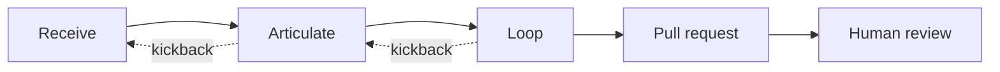

# Overview

ralph turns the RALPH method into tooling. A person and an agent work together to understand a request and write
down a plan. An agent then loops over that plan task by task, and the result arrives as a pull request for humans
to review.

## How each phase maps onto ralph

| Phase | Who | What ralph provides |
|---|---|---|
| **Receive** | Person and agent, interactive | High-level planning. `/ralph:receive` stores the instructions verbatim as an *initiative's* brief and resolves the high-level questions: goals, scope, constraints, and delivery order. It then creates the *milestones* and each milestone's *unplanned tasks* right away, or after the person approves the outline in plan mode when they ask for that or `receive.confirm_outline` is set. Revising an initiative always goes through plan-mode approval. |
| **Articulate** | Person and agent, interactive | Low-level planning. `/ralph:articulate` works through the unplanned tasks one at a time, asking about the details until each has a self-contained description and verifiable acceptance criteria, then promotes it from `PROPOSED` to `TODO`. Detailed design is recorded as *documents*. |
| **Loop** | Agent, headless | `ralph loop --milestone M-n` starts a fresh harness session for each `TODO` task. Each session reads its context from the store, implements one task, verifies it, and records the outcome. ralph commits each finished task on the milestone's branch. |
| **Pull request** | ralph | `ralph pr create --milestone M-n` opens one pull request per milestone on the configured host. *Planned; the dry run works today.* |
| **Human review** | People | Review, merge, and deploy happen outside ralph. Agents propose; people merge. |

## The pieces

- **Store.** A SQLite database inside the repository at `.ralph/ralph.db`. It is git-ignored, so each clone has its
  own. It holds initiatives, documents, milestones, tasks, and task notes.
- **Search.** Everything in the store is chunked and embedded through a local Ollama model. Search ranks results by
  vector similarity and falls back to keyword search when embeddings are unavailable.
- **MCP server.** `ralph mcp` exposes the store to the agent harness over stdio. Claude Code is the first supported
  harness.
- **CLI.** Every MCP capability is also available as a `ralph` subcommand, for people and scripts.
- **Configuration.** Layered YAML plus environment variables chooses the harness for each step, the embedding model,
  the loop policy, and the pull-request target.

## Manifesto clauses in the software

- **Kickback Clause.** A task can always return to `PROPOSED` (re-articulate) or go to `BLOCKED` (ask for help).
  Each such move is recorded as a `KICKBACK` note.
- **Stall Statute.** Every failed loop iteration increments a task's failure count. When the count reaches
  `loop.stall_threshold`, the task is moved to `BLOCKED` automatically instead of returning to `TODO`.
- **"Written plans over remembered intentions."** Loop iterations start with fresh context on purpose. The task
  description, acceptance criteria, notes, and documents are the only memory carried between iterations.
